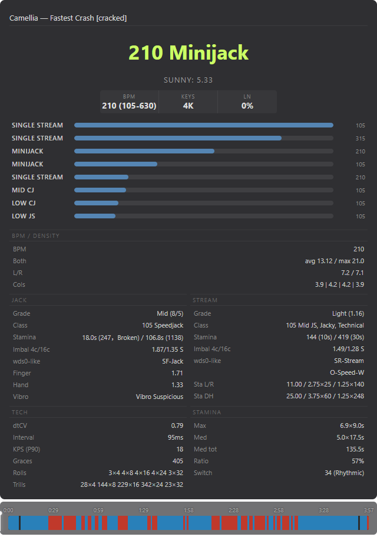

# osumania-estimator

A tosu overlay plugin that analyses osu!mania 4K beatmaps and reports key-pattern structure, pattern-class typing and difficulty estimates over the play area.

By Akuta Zehy · version 4.5.0 (`metadata.txt`)

## Requirements

- [tosu](https://tosu.app/) — the osu! client fork this overlay targets (`CompatibleWith: tosu`).
- Node.js 18+ to build from source; the deployed overlay itself is a static bundle.

## Quick start

Deploy the built folder `deploy/osumania-estimator by Akuta Zehy/` (index.html, metadata.txt, settings.json, styles/, dist/) into tosu's `static/` directory, then restart tosu or reload overlays.

To build it yourself:

```bash
npm install && npm run build
```

The build bundles `src/index.ts` with esbuild into `dist/index.js` and copies the overlay files into `deploy/osumania-estimator by Akuta Zehy/`.

## Usage

### Input

- **Beatmap** — the overlay fetches the loaded chart's `.osu` file from tosu (`http://localhost:24050/files/beatmap/file`) and parses it locally.
- **Mods** — speed rate, OD flag and conversion flag (IN/HO) come from the tosu websocket payload. Any change of the mod signature (`speedRate | odFlag | cvtFlag`) re-runs the analysis; an already-analysed (chart, mod) pair is served from an in-memory LRU cache of 50 entries.

### Output

- **Overlay card** (lobby and result screens): effective BPM, dominant key type, the Sunny star line, the key-type bars and the metric panels.
- **Metric panels**: BPM/DENSITY, LONG NOTE, JACK, STREAM, TECH and STAMINA — see the [metric index](#metric-index).
- **Section bar / in-game bar**: the whole-map segment structure, colour-coded by segment type; during play the in-game bar shows the segment under the playhead.

Detailed view card, rendered with `Camellia - Fastest Crash (inteliser) [cracked]`:



### Settings

Two checkboxes in tosu's overlay settings (`settings.json`):

| Setting | Effect |
| --- | --- |
| Show Pattern Breakdown | Toggle the key-type / pattern bars row |
| Show Custom Metrics | Toggle the BPM/DENSITY, LONG NOTE, JACK, STREAM, TECH and STAMINA panels |

## Metric index

Definitions, thresholds and terminology live in the [glossary](docs/glossary.md); this table only locates each metric.

| Metric | Unit | Range | Definition |
| --- | --- | --- | --- |
| BPM | BPM | chart value; `BPM (min-max)` on variable-speed charts | [顶部其余字段](docs/glossary.md#顶部其余字段) |
| 主键型 / 键型条 | enum | `Minijack`, `Low/Mid Chordjack`, `Mid Jumpstream`, … | [键型表](docs/glossary.md) |
| Sunny | stars | ≥ 0; shows `Sunny: 4.51 (+12.3%)` against the in-game star | [顶部其余字段](docs/glossary.md#顶部其余字段) |
| LN 面占比 | % | 0–100 (strict share ≤ total share) | [顶部其余字段](docs/glossary.md#顶部其余字段) |
| LN 图池分 CO/DE/WC/TE | points | 0–100, relative between the four pools | [LONG NOTE](docs/glossary.md#long-note-面板) |
| 面重叠 Overlap / 短面 Tap LN | pairs·% / count | ≥ 0 | [LONG NOTE](docs/glossary.md#long-note-面板) |
| 双手 / 单手 / 各列密度 | keys per second | ≥ 0 over a 1 s sliding window | [BPM / DENSITY](docs/glossary.md#bpm--density-面板) |
| JACK 密度档 Grade | enum | Mini / Low / Mid / Dense | [JACK](docs/glossary.md#jack-面板) |
| JACK 分类 Class | enum | Actually Not Jack / Speedjack / Bullet·Minijack / Low·Mid·High Chordjack / Anchor·X Chordjack | [JACK](docs/glossary.md#jack-面板) |
| JACK 耐力 Stamina | s + notes | ≥ 0, longest streak / total coverage | [JACK](docs/glossary.md#jack-面板) |
| 失衡度 Imbal 4c/16c | ratio | 1.0 balanced – 2.0 fully one-sided | [Imbal 4c/16c](docs/glossary.md#imbal-4c16c) |
| 单指压力 Finger / 单手压力 Hand | ratio | 1.0 balanced – 4.0 / 2.0 fully one-sided | [Finger / Hand](docs/glossary.md#finger--hand) |
| wds0-like 标记 | letters | `XY-Jack[-W]`, `XY-Stream`, `XY-Speed[-T\|-W]` | [wds0-like](docs/glossary.md#wds0-like) |
| Vibro | % + s | No Vibro / Vibro Suspicious / Vibro | [Vibro](docs/glossary.md#vibro) |
| STREAM 密度档 Grade | enum | Single / Light / Mid / Dense / Full / Heavy | [STREAM](docs/glossary.md#stream-面板) |
| STREAM 分类 Class | string | `{eff} {Full\|Dense\|Broken\|Mid} (JS\|HS\|SS)[, Jacky][, Technical]` | [STREAM](docs/glossary.md#stream-面板) |
| STREAM 耐力 Stamina | notes | max notes in any 10 s / 30 s window | [STREAM](docs/glossary.md#stream-面板) |
| 锚切耐力 Sta L/R、Sta Alt | measures | `P100 / P90=v×n / P50=v×n` | [Sta L/R / Sta Alt](docs/glossary.md#sta-lr--sta-alt) |
| 同指最小间隔 Interval | ms | ≥ 0 | [TECH](docs/glossary.md#tech-面板) |
| 持续键速 KPS (P90) | keys per second | ≥ 0 | [TECH](docs/glossary.md#tech-面板) |
| 滑键 Graces | count | ≥ 0 | [TECH](docs/glossary.md#tech-面板) |
| 滚键 Rolls / 快速交互 Trills | length×count | ≥ 0 | [TECH](docs/glossary.md#tech-面板) |
| 峰值 / 中位密度段 Max、Med | density×s | ≥ 0 | [STAMINA](docs/glossary.md#stamina-面板) |
| 中位以上总时长 Med tot / 主难覆盖率 Ratio | s / % | ≥ 0 / 0–100 | [STAMINA](docs/glossary.md#stamina-面板) |
| 叠切切换频率 Switch | count | ≥ 0 (saturates at 10+), 16-beat (64-row in 4K) window | [STAMINA](docs/glossary.md#stamina-面板) |

## Known limitations

- **4K only.** The key-type, grid and pattern algorithms assume a 4-column chart; other key counts are out of scope.
- **Very dense charts are skipped.** A chart with more than 30000 notes, or more than 15000 long notes, is reported as skipped instead of analysed.
- **LN pool scores are not a difficulty number.** They express relative probability between the four pools, so only their ordering is meaningful.
- **Without grid analysis the output degrades.** The key-type bars fall back to up to 4 interlude-cluster bars, and the density grades fall back to a 4-row sliding-window tier.
- **Sunny falls back to a density estimate.** Below a 0.01 algorithm result the star is estimated from density, and the comparison against the in-game star is then omitted.
- **Anchor stamina shows two of the three tiers.** The single-hand and dual-hand tiers are displayed (`Sta L/R`, `Sta Alt`); the single-finger tier is computed for calibration and stays internal.

## Docs

- [docs/glossary.md](docs/glossary.md) — the single source of truth for metric definitions, thresholds and terminology.
- [docs/ALGORITHM.md](docs/ALGORITHM.md) — how each number is produced: formulas, thresholds and their source locations.
- [CHANGELOG.md](CHANGELOG.md) — version history.

## Build & test

```bash
npm install && npm run build     # esbuild → dist/index.js, then copied into deploy/
npm run typecheck                # tsc --noEmit
npm test                         # vitest
npm run bench                    # perf benchmark (npm run bench:stages for per-stage breakdown)
```

Test maps live in `maps/`, vitest suites in `test/*.test.ts`; the remaining files in `test/` and `scripts/` are one-off diagnostic and benchmark scripts.

## Acknowledgments

- [Sunny Rework](https://github.com/sunnyxxy/Star-Rating-Rebirth) — star rating algorithm
- [osumania_map_analyser](https://github.com/LeoBlackMT/osumania_map_analyser) — reference implementation
- [wds0 Dan](https://www.bilibili.com/opus/1237321666437054472) — wds0-like marker system
- [Guanjing Scene](https://github.com/guanjing1462-creator/guanjing-scene) — anchor algorithm reference ([web](https://guanjingscene.xyz/))
- [Interlude](https://github.com/YAVSRG/YAVSRG) · [Etterna](https://github.com/etternagame/etterna) · [tosu](https://tosu.app/) · [osu](https://github.com/ppy/osu)

Thanks to [sunnyxxy](https://github.com/sunnyxxy/), [Leo_Black](https://github.com/LeoBlackMT), [wds0](https://osu.ppy.sh/users/8771622), [Guanjing](https://github.com/guanjing1462-creator) & [AquaStone](https://github.com/AquaStoneLZS), and [FutureLK](https://osu.ppy.sh/users/24038353).

## License

This repository ships no license file. Treat the code as all-rights-reserved and contact the author before reuse.
